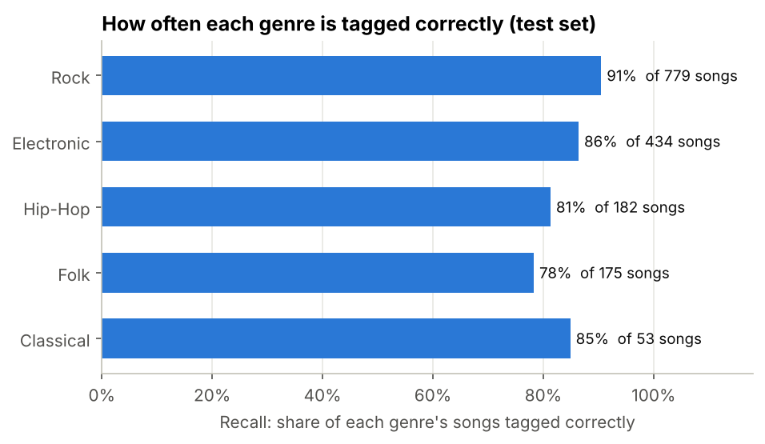
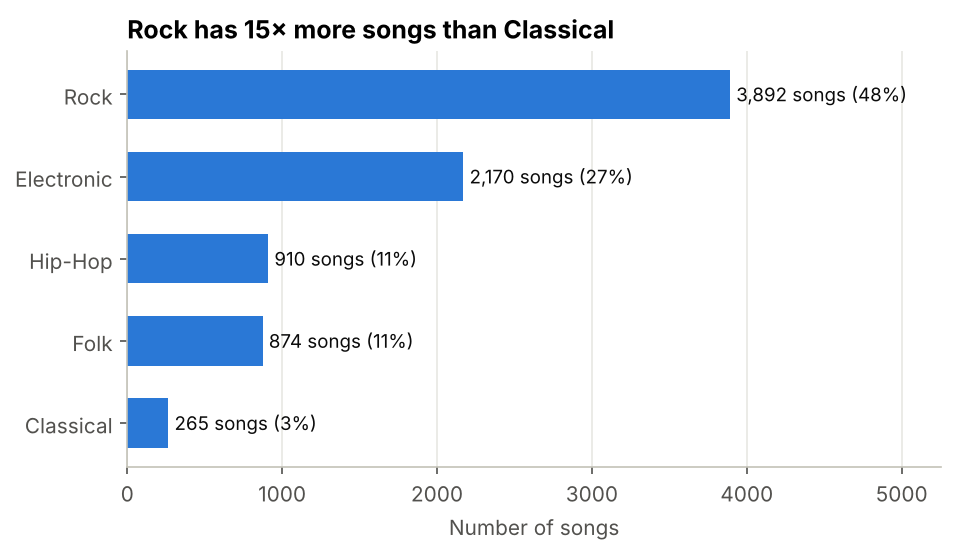
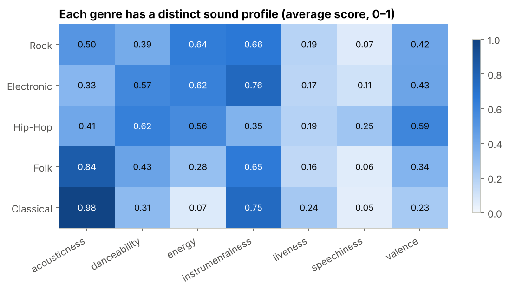
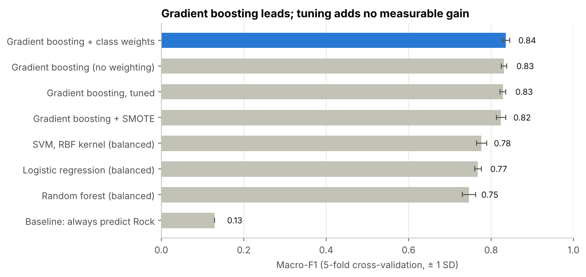
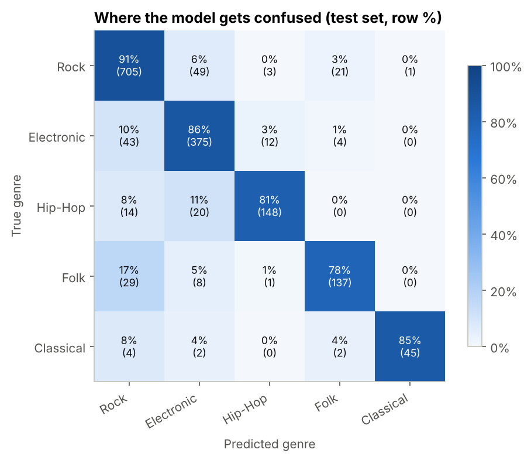
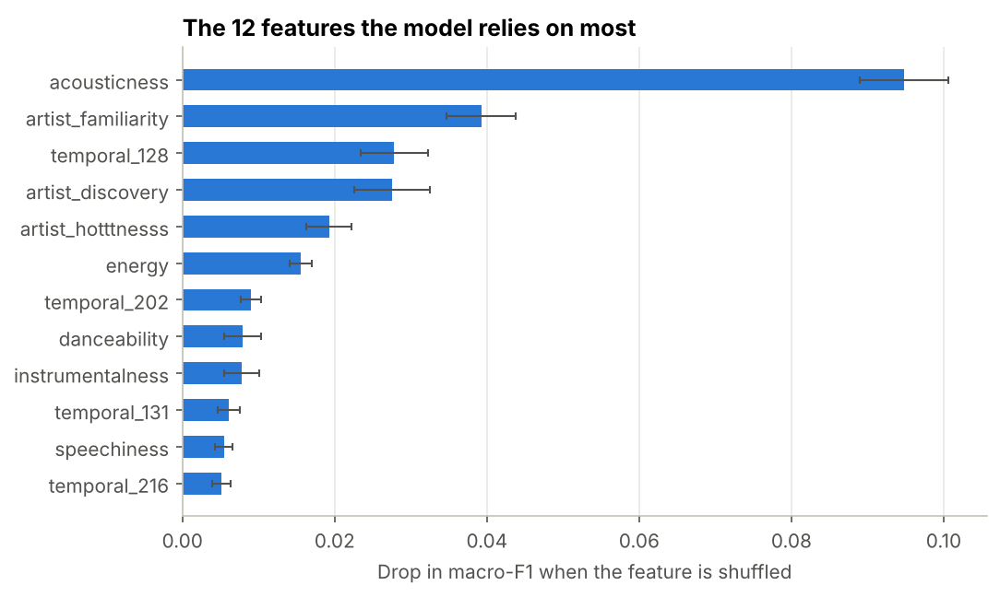
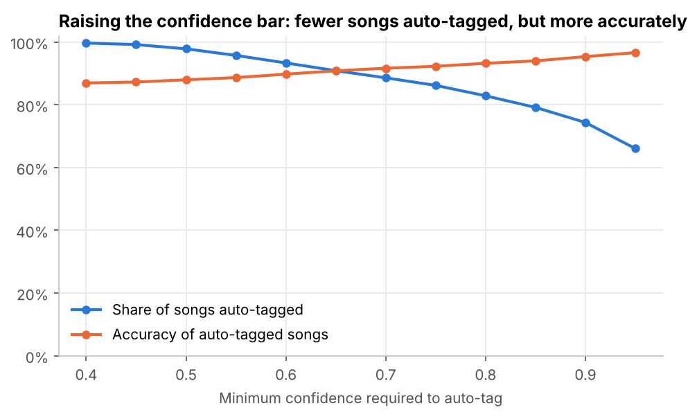

# Music Genre Tagging: Accuracy You Can Trust Across Every Genre

**Client question:** a music streaming service wants to auto-tag the genre of new songs. *How accurate would it be, and is it reliable for every genre, not just the common ones?*

**Data:** 8,111 songs from the Free Music Archive across 5 genres (Rock, Electronic, Hip-Hop, Folk, Classical), each with 237 numeric audio and popularity features.

---

## The answer

| Question | Answer |
|---|---|
| **Can genre tagging be automated?** | **Yes.** On 1,623 songs the model never saw, it tags **87% correctly**, with a **macro-F1 of 0.86** (cross-validation estimate 0.84). |
| **Does it work for every genre?** | **Yes, with one weak spot.** Every genre is tagged correctly at least **78%** of the time. **Folk** is the weakest, and is most often mistaken for Rock. |
| **How should it be used?** | **Auto-tag when the model is ≥ 80% confident.** That covers **83% of songs at 93% accuracy**, and the remaining ~1 in 6 songs go to an editor. |



---

## How I got there

### 1. The genres are heavily imbalanced
Rock makes up 48% of songs and Classical only 3%. A model that always guesses "Rock" scores **48% accuracy** but a macro-F1 of just **0.13**. That's why every model here is judged on **macro-F1**, where every genre counts equally, and **per-genre recall**.



### 2. Each genre has a distinct sound
Classical is almost purely acoustic, with very low energy. Hip-Hop has more than double the speechiness of any other genre. Electronic is the most instrumental and least acoustic.



### 3. I compared eight approaches, with every experiment in the code
All scored by 5-fold stratified cross-validation on the training set (80% of songs). The test set stayed untouched until the very end.



| Approach | Macro-F1 | Verdict |
|---|---|---|
| Always predict Rock | 0.13 | Baseline: shows accuracy alone misleads |
| Random forest (balanced) | 0.75 | Rejected: tags only 44% of Folk correctly |
| Logistic regression (balanced) | 0.77 | Strong simple baseline, but weak on Rock and Electronic |
| SVM, RBF kernel (balanced) | 0.78 | Better, still well behind boosting |
| Gradient boosting + SMOTE | 0.82 | Rejected: oversampling, applied inside each fold, slightly *hurt* |
| Gradient boosting, tuned | 0.83 | Rejected: tuning gave no gain over the defaults |
| Gradient boosting, no weighting | 0.83 | Good, but weaker on Folk and Hip-Hop |
| **Gradient boosting + class weights** | **0.84** | **Final model:** best macro-F1, chosen on cross-validation alone |

### 4. Where the model gets confused
Almost every mistake involves the two biggest genres. **17% of Folk** is tagged as Rock, and **11% of Hip-Hop** is tagged as Electronic. Classical is almost never mistaken for anything else: when the model says Classical, it is right **98%** of the time.



### 5. What drives the predictions
**Acousticness** is by far the most important feature. The artist popularity scores also rank highly, which is a caveat: brand-new artists with no popularity history give the model less to work with. The 13 named features carry **44%** of the model's signal despite being only 5% of the columns.



### 6. Turning it into a workflow
The confidence threshold is a business dial. A higher threshold means fewer songs are auto-tagged, but more accurately.



| Minimum confidence | Songs auto-tagged | Accuracy of those tags | Sent to review (of 1,623) |
|---|---|---|---|
| 60% | 93% | 90% | 108 |
| **80% (recommended)** | **83%** | **93%** | **278** |
| 90% | 74% | 95% | 416 |

At 80%, the review queue is weighted towards the hardest genres: about 27% of Folk and 22% of Electronic songs go to an editor, against 12% of Rock.

---

## Recommendations

1. **Deploy with a human in the loop:** auto-tag at ≥ 80% confidence and route the rest to editors.
2. **Prioritise Folk** for editor review and for collecting more training examples. It's the genre most often mislabelled.
3. **Watch new artists.** Popularity features matter, so monitor accuracy for artists without a track record.
4. **Plan on a macro-F1 of about 0.84** (the cross-validated figure) rather than the slightly higher test score, and re-check performance as the catalogue grows.

---

## Notebooks

| Notebook | What it covers |
|---|---|
| [`01_data_exploration.ipynb`](notebooks/01_data_exploration.ipynb) | Loading and naming the 237 features, data quality checks, genre balance, genre sound profiles |
| [`02_modelling.ipynb`](notebooks/02_modelling.ipynb) | Eight-model comparison, imbalance handling, held-out test evaluation, confusion analysis, feature importance, confidence-based workflow |

## Structure

```
music-genre-analysis/
├── data/
│   ├── raw/music.csv                       # original data (no header row)
│   └── processed/                          # model outputs (ready for BI tools)
│       ├── model_comparison.csv
│       ├── test_genre_metrics.csv
│       ├── confusion_matrix.csv
│       ├── test_predictions.csv
│       ├── confidence_tradeoff.csv
│       ├── feature_importance.csv
│       └── genre_profiles.csv
├── notebooks/
│   ├── music_data.py                       # shared data loader with column names
│   ├── 01_data_exploration.ipynb
│   └── 02_modelling.ipynb
├── images/                                 # charts used in this README
└── requirements.txt
```

## How to run

```bash
git clone https://github.com/abir110/music-genre-analysis.git
cd music-genre-analysis
pip install -r requirements.txt
jupyter lab notebooks/
```

Run `01_data_exploration.ipynb`, then `02_modelling.ipynb`. The modelling notebook takes about **30 minutes** on a laptop, mostly the hyperparameter search. All randomness is seeded, so results are reproducible.

## Tools

Python · pandas · NumPy · scikit-learn (gradient boosting, SVM, logistic regression, random forest, cross-validation, permutation importance) · imbalanced-learn (SMOTE) · Matplotlib

## About the data

Extract from the Free Music Archive (Defferrard et al., 2017, *FMA: A Dataset for Music Analysis*), provided for the classification coursework in my MSc Data Science *Machine Learning* module at Aston University. The file has no column names. I mapped them to the FMA Echonest feature set (8 audio descriptors, 5 popularity scores and 224 temporal features) and confirmed the mapping from the value ranges.

---

**Author:** Abir Alam Srabon · [LinkedIn](https://www.linkedin.com/in/abir-alam-srabon) · [GitHub](https://github.com/abir110) · [Portfolio](https://abir110.github.io)
